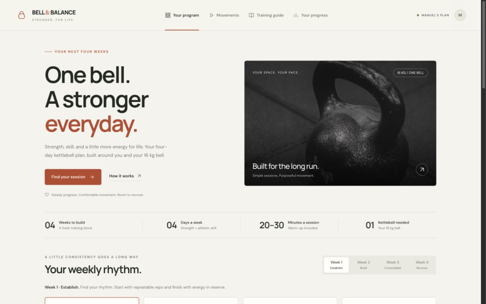

# Bell & Balance

A responsive kettlebell training dashboard built with **Astro and TypeScript**. Four weeks, four training days per week, and one 16 kg kettlebell. Sessions take 20–30 minutes, including warm-up and cooldown.



## Features

- **16 guided sessions** with week/day selection, optional rep progression, and a lighter fourth week.
- **Interval timer** with pause/resume, rest after finishing reps, manual advance, restart, and optional sound.
- **20-minute options** for every session; all week-four sessions use this duration.
- **11 movement tutorials** with video demonstrations, coaching cues, common mistakes, and suggested replacements.
- **Training guide** explaining EMOM, E2MOM, complexes, AMRAP, for time, and straight sets.
- **Progress journal** with a session calendar, effort and recovery notes, editing, deletion, and JSON export.
- **Printable program** available from the site.
- Responsive layouts for phones, tablets, and desktops.

## Getting started

Requires **Node.js 22.23.4 or newer** and npm. Use a current supported Node.js LTS release that meets this minimum.

```sh
npm ci
npm run dev
```

Open the URL printed by Astro, normally [localhost:4321](http://localhost:4321).

## Commands

| Command                | Purpose                              |
| ---------------------- | ------------------------------------ |
| `npm run dev`          | Start the development server         |
| `npm run check`        | Check Astro and TypeScript files     |
| `npm run build`        | Generate the static site in `dist/`  |
| `npm run preview`      | Preview the production build locally |
| `npm run format`       | Format source files                  |
| `npm run format:check` | Check source formatting              |

In restricted environments, prefix Astro commands with `ASTRO_TELEMETRY_DISABLED=1` to avoid writing telemetry preferences outside the project.

## Project structure

```text
.
├── docs/                    # README preview
├── public/
│   ├── downloads/           # Printable training program
│   └── favicon.svg
├── src/
│   ├── components/         # Shared icons and movement cards
│   ├── data/               # Program steps and movement references
│   ├── layouts/            # Shared page layout and navigation
│   ├── pages/              # Program, movements, guide, and progress
│   ├── scripts/            # Timer, search, dialogs, and journal
│   └── styles/             # Responsive styling
├── astro.config.mjs
├── package.json
└── tsconfig.json
```

### Updating the content

- `src/data/program.ts`: session steps, repetitions, durations, and progression.
- `src/data/movements.ts`: exercise explanations, replacement doses, and video references.
- `src/pages/guide.astro`: training formats, progression advice, and sources.
- `src/styles/global.css`: visual design and responsive breakpoints.

## Timer and training behavior

Rep increases are optional targets. Keep the starting reps or repeat a week when recovery requires it. AMRAP and for-time examples in the guide are educational; they are not added to this training block.

The timer includes work **and** recovery. **Reps done · rest** keeps the current interval running. Manual advance shortens the session, and actual minutes can be adjusted when logging. Closing the timer pauses it. Changing the session or reloading/navigating away resets it. Keep the page open and the screen awake for timely cues; background browser behavior can delay audio.

## Privacy and storage

The journal stays in the current browser and origin, under the localStorage key `bell-balance-logs-v1`. There is no backend, account system, analytics, or cloud sync. Clearing browser data removes the journal. JSON export provides a downloadable copy; importing a journal is not currently supported.

Laboratory reports and personal journal entries are not part of this repository. Generated builds, dependencies, local environment files, and logs are ignored by Git.

## Deployment

```sh
npm ci
npm run check
npm run build
```

Deploy the generated **`dist/` directory** to a static host. No server runtime or environment secrets are required. The site currently expects a domain root because its navigation and download links are root-relative. For subdirectory hosting, configure Astro’s `base` and update those links before building.

## Media and credits

Exercise videos are embedded from YouTube only after pressing play. Thumbnails load from YouTube, the hero photograph from Unsplash, and fonts from Google Fonts. These resources require internet access, and creators control video availability. Each movement also provides a link to the original video.

Demonstration creators include **Lebe Stark, E3 Rehab, Kathletics, NASM, and Zack Henderson**. Full credits and clinical background sources are linked in the Training guide. Third-party media remains with its creators.

This is an original personal training project inspired by the user's kettlebell preferences. It is not an official Lebe Stark product or endorsement. Training guidance does not replace individualized advice from a treating clinician.

## Validation

Astro/TypeScript checks and the production build pass. Browser checks cover session durations, 20-minute variants, automatic interval advancement and timer controls, movement search and filtering, video loading, and journal save/update/export/delete and persistence. Layouts were checked from 320 to 1440 pixels. Temporary journal testing used a separate local origin.
